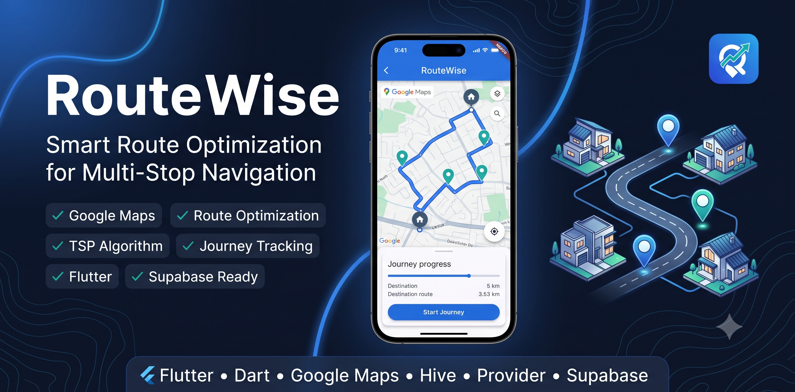

# RouteWise - Smart Route Optimization



RouteWise is a premium, modern route optimization and planning application built using **Flutter & Dart**. Designed to solve the classic Traveling Salesperson Problem (TSP), RouteWise helps logistics, delivery, and travel enthusiasts visit multiple locations in the most mathematically efficient order and return home safely.

Featuring a beautiful, modern Material 3 interface, native Google Maps integrations, dynamic TTS voice prompts, and robust offline caching, RouteWise provides a state-of-the-art dispatch and travel assistance experience.

---

## 🚀 Key Features

*   **Intelligent Route Optimization (TSP)**:
    *   Evaluates multi-coordinate structures to determine the shortest round-trip path.
    *   Utilizes a fast **Nearest Neighbor Heuristic** algorithm ($O(N^2)$) to compute high-efficiency route sequences instantly, keeping the UI highly responsive.
*   **Google Maps Interactive Routing**:
    *   Renders optimized polyline paths directly onto an interactive Google Map view.
    *   Visualizes location markers clearly:
        *   🏠 **Home Base** (Red marker)
        *   📍 **Active Destination** (Orange marker)
        *   🔵 **Pending Stops** (Blue markers)
        *   ⚪ **Visited Stops** (Greyed-out indicators)
        *   🟣 **Your Live Position** (Violet marker)
*   **Start Journey & One-Click Navigation**:
    *   Real-time journey progress dashboard showing completion percentages, elapsed timers, and remaining stops.
    *   One-click native deep linking opens turn-by-turn routing directly inside system navigation apps (native Google Maps directions).
    *   Allows active stops to be checked off as **Completed** or **Skipped** (which re-routes and re-optimizes remaining stops starting from your current location).
*   **Automatic Arrival Detection & Voice Alerts**:
    *   Live GPS tracking coordinates retrieved using `Geolocator`.
    *   Pops up confirmation cards automatically when entering a configurable arrival radius (e.g. 50 meters).
    *   Voice Guidance synthesis announces alerts out loud: *"You have arrived at <Stop Name>"*.
*   **Journey Settings Dashboard**:
    *   Change arrival detection radius dynamically (10m to 200m).
    *   Select GPS precision layers (low, medium, or high accuracy).
    *   Toggle Text-To-Speech (TTS) alerts, map auto-centering, and keep display awake rules (`wakelock_plus`).
*   **Local Caching & Sync**:
    *   Powered by `Hive` for secure key-value local state persistence (cached configurations, routes, and settings).
    *   Supabase cloud sync integration ready to backup and restore route records from remote tables.

---

## 🛠️ Project Architecture

```
RouteWise/
├── pubspec.yaml                 # Packages, assets, and project dependencies
├── README.md                    # Main project documentation
├── banner.png                   # Brand cover asset
└── lib/
    ├── main.dart                # Bootstrap, initialization, and Provider state setup
    ├── models/
    │   ├── location.dart        # Location entity representing home base & route stops
    │   ├── place_suggestion.dart# Autocomplete address search suggestion entity
    │   ├── route_snapshot.dart  # Active route snapshot state representation
    │   ├── journey_state.dart   # Tracking stats, elapsed durations, and visited indicators
    │   └── journey_settings.dart # Configuration rules (radius, voice, wake locks, map center)
    ├── screens/
    │   └── home_screen.dart     # Main dashboard interface with Map, Stops, and Directions tabs
    ├── services/
    │   ├── route_provider.dart  # Core state machine linking streams, locations, and actions
    │   ├── location_tracker_service.dart # Real-time Geolocator position stream listener
    │   ├── arrival_service.dart    # Mathematical boundary checker for stop proximity
    │   ├── voice_guidance_service.dart # Vocal prompt builder using flutter_tts
    │   ├── directions_service.dart # Retrieves polylines and durations from Google Directions SDK
    │   ├── geocoding_service.dart  # Converts coordinates to user-friendly address strings
    │   ├── places_service.dart     # Auto-suggests search results using Google Places API
    │   ├── route_optimizer.dart    # Heuristic mathematics TSP engine solver
    │   ├── storage_service.dart    # Local Hive cache configuration layer
    │   └── navigation_service.dart # Dispatches platform-specific driving directions links
    ├── utils/
    │   ├── constants.dart       # Design system colors, margins, styles, and dimensions
    │   └── theme.dart           # Custom Material 3 Light/Dark theme setups
    └── widgets/
        ├── google_map_widget.dart   # Google Maps canvas rendering pins and polyline routes
        ├── journey_status_card.dart   # Floating real-time overlay showing speed, accuracy, ETA
        ├── journey_settings_sheet.dart # Slide-up M3 configuration controller
        ├── arrival_bottom_sheet.dart  # Prompt popping up on target coordinates arrival
        ├── route_timeline.dart      # Vertically ordered route timeline stepper
        └── add_location_dialog.dart # Search bar containing Places auto-suggestions list
```

---

## 🚀 Setup & Installation

### Step 1: Install Flutter SDK
If you do not have Flutter installed:
1. Download the SDK from the [Official Flutter Installation Guide](https://docs.flutter.dev/get-started/install).
2. Configure environment system path variables.
3. Run the doctor tool to verify:
   ```bash
   flutter doctor
   ```

### Step 2: Fetch Project Dependencies
Run package retrieval commands:
```bash
flutter pub get
```

### Step 3: Run the Application
Launch the debug app on Chrome or a connected simulator/device:
```bash
flutter run
```

---

## 🔑 Environment Configuration

Create a `.env` file at the root of the project to initialize the Google Maps SDK keys:

```env
GOOGLE_MAPS_API_KEY=YOUR_GOOGLE_MAPS_API_KEY_HERE
```
*Note: Make sure your key has access permissions enabled for: **Maps SDK for Android/iOS/Web**, **Directions API**, **Geocoding API**, and **Places API**.*

---

## ⚙️ Native Build Integrations

### Android Setup
1. Insert your API key inside [AndroidManifest.xml](file:///c:/Saravanakumar G/Projects/RouteWise/android/app/src/main/AndroidManifest.xml) under `<application>`:
   ```xml
   <meta-data android:name="com.google.android.geo.API_KEY"
              android:value="YOUR_ANDROID_API_KEY_HERE"/>
   ```
2. Set location permission definitions in the manifest:
   ```xml
   <uses-permission android:name="android.permission.ACCESS_FINE_LOCATION" />
   <uses-permission android:name="android.permission.ACCESS_COARSE_LOCATION" />
   ```

### iOS Setup
1. Register descriptions inside [Info.plist](file:///c:/Saravanakumar G/Projects/RouteWise/ios/Runner/Info.plist):
   ```xml
   <key>NSLocationWhenInUseUsageDescription</key>
   <string>RouteWise needs location access to track your progress.</string>
   <key>NSLocationAlwaysUsageDescription</key>
   <string>RouteWise needs background location access to track your progress.</string>
   ```
2. Initialize `GMSServices` in `AppDelegate.swift` before running:
   ```swift
   GMSServices.provideAPIKey("YOUR_IOS_API_KEY_HERE")
   ```
